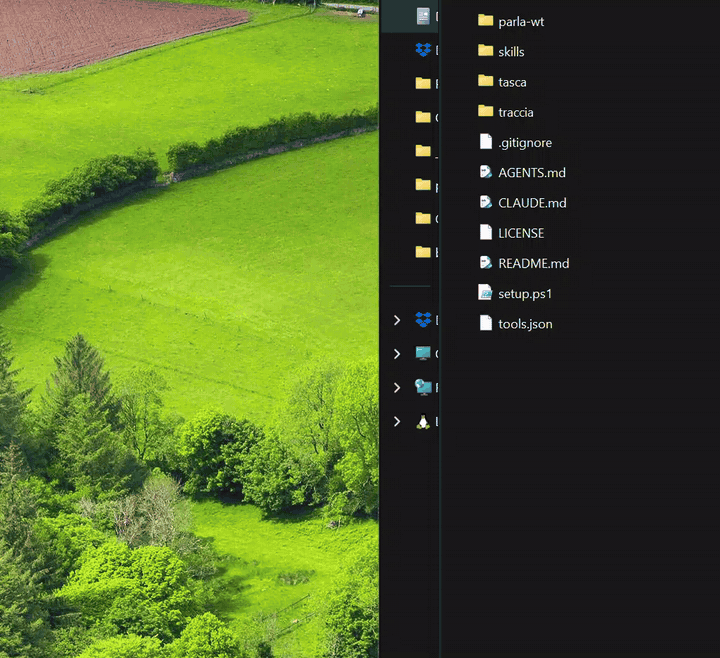
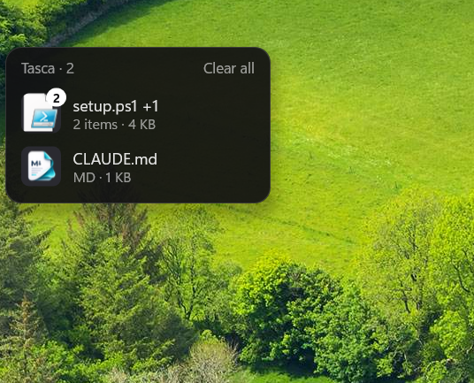

# Tasca

A file shelf and a clipboard history for Windows. Drop files on the Shelf, keep working, drag them out into any app. Press Alt+V to paste something you copied earlier.



## What it does

- **Summon it mid-drag.** Press **Ctrl+Alt+D** (Tasca's global shortcut, or
  `tasca.exe toggle` from your own tool) and a compact list slides out of the
  left edge of the monitor under the pointer — even while you are already
  dragging something.
- **Park files by dropping them on the Shelf.** Files and folders are kept by
  path. Browser images, links and text snippets are written to a temporary file
  first, so they can be dragged out like any other file. Several files dropped
  together become one **Stack** and are taken out as a unit.
- **Keep working.** The Shelf stays out of the way and does not take focus from
  the app you are working in (its right-click menu is the only exception); it
  hides when you toggle it away or take out the last Item. Parking the same
  files again just moves that Item back to the top.
- **Take them out into any app, folder or chat.** Tasca itself never moves,
  renames or deletes your files — the app you drop them on decides what happens.
- **Nothing to manage.** One resident process per user with a tray icon, a few
  MB and no database. Settings are one small text file you can edit by hand.
  Thumbnails come from the shell, with tiles for images, folders and file types
  as a fallback.
- **Materialized files are temporary.** Anything that was not a file to begin
  with lives in `%TEMP%\Tasca\<drop-id>\`, and drop folders older than 24 hours
  are swept at startup. Your real files are never touched. Tasca also keeps
  `%LOCALAPPDATA%\Tasca\settings.ini` (your settings), `tasca.log` (a debug
  log, with the previous run kept as `tasca.log.1`) and the clipboard History
  in `%LOCALAPPDATA%\Tasca\history\`; that is all it writes.
- **A clipboard history next to it.** Press **Alt+V** and a list of what you
  copied opens at the pointer. See [Clipboard History](#clipboard-history).

Pure Rust on plain Win32/OLE: no webview, no Electron, no runtime to install.
The app icon is the Shelf at the edge of the screen; it shows on the exe, in
the tray and in Settings.



## Download & install

Prebuilt builds are on the [Releases page](https://github.com/matdac12/tasca/releases).

1. Download `tasca-<version>-windows-x64.zip` and unzip it anywhere.
2. In the unzipped folder, run:

   ```
   powershell -ExecutionPolicy Bypass -File install.ps1
   ```

The script copies `tasca.exe` into `%LOCALAPPDATA%\Tasca\`, adds the Startup
shortcut `Tasca.lnk` (which runs `tasca.exe --hidden`) and starts Tasca hidden.
Rerun it to update; it quits a running Tasca first.

Each release also attaches `tasca.exe` and `SHA256SUMS.txt` on its own, if you
would rather place the exe yourself. Check a download with
`Get-FileHash tasca.exe -Algorithm SHA256` and compare it to `SHA256SUMS.txt`.

Tasca is not code-signed yet, so Windows SmartScreen may warn if you start a
downloaded `tasca.exe` directly: choose **More info** → **Run anyway**.
`install.ps1` removes that download mark from the copy it installs (with
`Unblock-File`); for a standalone `tasca.exe`, run `Unblock-File .\tasca.exe`
once yourself.

Needs Windows 10 or 11, x64. No admin rights: the binary and the shortcut live
in your own profile.

## Usage

```
tasca.exe [toggle | quit | --hidden]
```

| Argument   | What it does                                                     |
| ---------- | ---------------------------------------------------------------- |
| none       | Shows the Shelf, starting Tasca first if it is not running       |
| `toggle`   | Shows or hides the Shelf — bind this to your shortcut            |
| `quit`     | Ends the resident                                                |
| `--hidden` | Starts the resident without showing anything (Startup shortcut)  |

Only one resident runs per user; every invocation talks to it, so the extra
process exits immediately. Launch Tasca unelevated: an elevated launch relaunches
itself through `explorer.exe`, because Windows blocks drag-and-drop between
different integrity levels.

On the Shelf: double-click opens an Item, drag it out to hand it to another app,
click / Ctrl-click / Shift-click selects, the wheel scrolls a long list, and
right-click offers **Remove**, **Clear all** and **Quit**.

## Clipboard History

Tasca records what you copy as a **Clip** and lists the Clips in a dark panel.
Press **Alt+V** from any app and the panel opens at the pointer, kept inside
the monitor's work area. Unlike the Shelf, it takes keyboard focus while it is
open, so you can type at once.

| Key or click                    | What it does                                                          |
| ------------------------------- | --------------------------------------------------------------------- |
| Type                            | Searches. Every word must appear in the Clip, in any order, ignoring case |
| Up / Down, PgUp / PgDn          | Moves the selection (the first row is selected on open)               |
| Enter, or click                 | Pastes the Clip into the app you came from and closes the panel       |
| Shift+Enter, or Shift+click     | Pastes it as plain text                                               |
| Alt+1 to 9, or Ctrl+1 to 9      | Pastes the Clip with that number, even while Alt is still held from Alt+V |
| Ctrl+P                          | Pins or unpins the selected Clip                                      |
| Ctrl+Delete                     | Deletes the selected Clip, pinned or not                              |
| Right-click a row               | Paste, Paste as plain text, Pin/Unpin, Delete                         |
| **Clear** (footer)              | Deletes every unpinned Clip, without asking. Pins stay                |
| Esc                             | Clears the search; on an empty search, closes the panel               |
| Alt+V again, or click elsewhere | Closes the panel, nothing pasted                                      |

Pinned Clips sit on top under **Pinned**, the rest under **Recent**, newest
first. The numbers on the left follow the list as shown, so after a search
Alt+1 pastes the first match. Bare digits go into the search. File Clips are
found by file name. Image Clips never match a search.

The pasted Clip stays on the clipboard and moves to the top, so a second
Ctrl+V pastes it again. If the app you came from runs as administrator,
Windows blocks the keystroke; the Clip is on the clipboard, so press Ctrl+V
yourself. **Show clipboard history** in the tray menu opens the panel with no
app to paste into, so choosing a Clip copies it and pastes nothing.

**What is kept.** Text with its formatting (HTML and RTF, so bold and links
survive a paste into Outlook or Word), images (stored as PNG) and files copied
in Explorer (their paths; pasting puts the same files on the clipboard
again). Copying something already in the History moves its Clip to the top and
keeps its pin. A single copy over 10 MB is skipped. Tasca keeps the newest 100
unpinned Clips and every pin, saved under `%LOCALAPPDATA%\Tasca\history\`, so
they survive Quit and reboots. A damaged History starts empty instead of
stopping Tasca.

**Private copies.** Copies that password managers mark as private are skipped
by default, so passwords do not land in a file on disk.

**Settings** has three History rows:

- **Clipboard history**, on by default. Off stops recording and frees Alt+V;
  the saved History stays on disk and returns when you turn it back on.
- **History shortcut**, Alt+V by default, recorded and checked by the same
  rules as the Shelf shortcut. The Shelf and the History cannot share a
  combination.
- **Skip private copies (password managers)**, on by default. Untick it to
  record those copies like any other Clip.

They are stored in `settings.ini` as `history=`, `history_shortcut=` and
`skip_private=`.

**Another clipboard manager on Alt+V.** Only one program can hold a hotkey. If
ClipClip (or a similar tool) already owns Alt+V, close it or change its
shortcut first. Otherwise Tasca keeps running and says so in the tray tooltip
and the Settings window; pick another History shortcut there. While the
History is on, Tasca takes Alt+V in every app, so a program that uses it as a
menu key (the View menu) loses it.

## Shortcut, tray and settings

Tasca lives in the notification area. Left-click the tray icon, or press the
global shortcut (**Ctrl+Alt+D** by default), to show or hide the Shelf.
Right-click the icon for **Show shelf**, **Show clipboard history**,
**Settings…** and **Quit**.

**Settings** lets you:

- record a different global shortcut, or clear it to **None**. The recorder
  accepts any combination that includes Ctrl, Alt or Win (Shift alone is not
  enough), or an F13–F24 key on its own; Alt+F4, Alt+Tab, Alt+Space and
  Ctrl+C/V/X/Z/A/S are refused;
- turn **Start with Windows** on or off — this creates or removes
  `%APPDATA%\Microsoft\Windows\Start Menu\Programs\Startup\Tasca.lnk`, the same
  shortcut `install.ps1` creates;
- set up the Clipboard History (see above);
- see the installed version.

Settings are stored in `%LOCALAPPDATA%\Tasca\settings.ini` as plain
`key=value` text, for example `shortcut=Ctrl+Alt+D`. Delete the file to return
to the default. If another app already owns the combination, Tasca keeps
running and says so in the tray tooltip and the Settings window; pick another
combination or clear it. A `shortcut=` line in that file that is unsafe by the
rule above, or cannot be read, falls back to the default. If saving your
settings or **Start with Windows** fails, Tasca keeps running and says so in the
tray tooltip. `tasca.exe toggle` still works, so Hyperkey, AutoHotkey or
PowerToys users can bind it themselves.

## Build from source

Needs Windows 10 or 11, [Rust](https://rustup.rs) (the version is pinned in
`rust-toolchain.toml`) and the MSVC build tools (Visual Studio's "Desktop
development with C++" workload). Nothing else.

```
cargo build --release        # target\release\tasca.exe
cargo clippy --all-targets -- -D warnings
cargo test
```

The integration tests start a real resident, so end any running Tasca first
(`"%LOCALAPPDATA%\Tasca\tasca.exe" quit`) and run them one at a time.

To build and install in one go:

```
powershell -ExecutionPolicy Bypass -File scripts\install.ps1
```

When a `tasca.exe` sits next to the script — as in an unzipped release — the
script installs that file instead of building.

## Releasing

Releases are cut from `main` by pushing a tag; CI does the rest.

1. Bump `version` in `Cargo.toml`.
2. Move the `Unreleased` entries in `CHANGELOG.md` under the new version, with
   the date.
3. Commit, then tag and push:

   ```
   git tag v0.2.0
   git push origin v0.2.0
   ```

The tag must be `v` plus the exact `Cargo.toml` version.
`.github/workflows/release.yml` runs the same checks as CI, fails if the two
disagree, and publishes a GitHub Release with generated notes, `tasca.exe`,
`tasca-<version>-windows-x64.zip` and `SHA256SUMS.txt`.

## Development

`AGENTS.md` has the rules: module layout, the frozen window-class and message
interface in `src/proto.rs`, the "never block the UI thread" rule, elevation,
and the three checks CI runs.

## License

MIT — see [LICENSE](LICENSE). Copyright (c) 2026 Mattia Da Campo.
